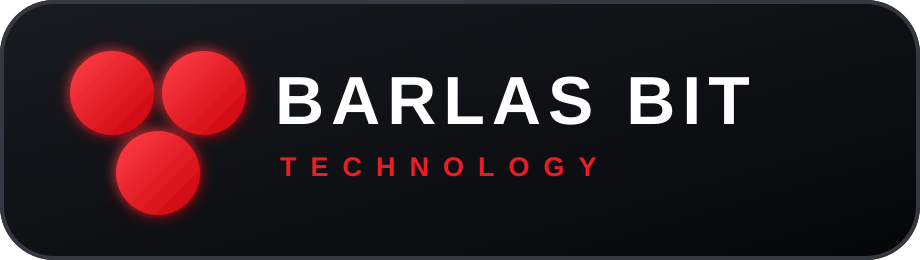

<div align="center">
  
  <h1>BARLAS Browser</h1>
  <p><strong>A fast, focused desktop browser by Barlas Bit Technology.</strong></p>
  <p>Think ahead. Act beyond.</p>

  [](https://www.electronjs.org/)
  [](LICENSE)
  [](#project-status)
</div>

<br>


BARLAS Browser is an open desktop browser built on Chromium. It combines broad
website compatibility with a compact Opera-inspired interface, a clear security
boundary, and a focused roadmap for everyday browsing.

> [!IMPORTANT]
> This repository is an early alpha. It is useful for development and testing,
> but it has not yet received the security review required for daily use with
> sensitive accounts.

## What works today

- Chromium-compatible browsing in independent tabs
- Google search directly from the address bar
- Automatic localization for 251 countries and territories across 79 primary languages
- Manual language selection including 35 Turkic languages and Mongolian
- Local bookmarks with a dedicated sidebar
- Browsing history with search, individual removal, full clearing, and `Ctrl+H`
- Date-grouped history persisted across browser updates and restarts (up to 5,000 entries)
- Automatic restore of open web tabs after restart
- Reopen the last closed tab with `Ctrl/Cmd + Shift + T`
- Download center with live progress, open-file, and show-in-folder actions
- Native in-browser updates with download progress and restart-to-install
- Working settings for search engine, interface language, and startup restore
- Browser menu with downloads, zoom, fullscreen, and version information
- Back, forward, reload, stop, home, and common keyboard shortcuts
- Popup links converted into controlled tabs
- Persistent browser profile and native downloads
- Custom black-and-red BARLAS interface and application icon
- Isolated page processes with no Node.js access
- Deny-by-default policy for sensitive website permissions

## Quick start

### Windows installer

Download the current installer from the
[latest GitHub release](https://github.com/WatcherAI-1997/barlas-browser/releases/latest).
Run `BARLAS-Browser-Setup-0.3.1-Windows-x64.exe`, choose an installation
directory, and complete the black-and-red setup wizard. On the final page you
can optionally add a desktop shortcut before launching the browser.

The alpha installer is not yet code-signed, so Windows SmartScreen may identify
it as an unknown publisher. Verify the SHA-256 checksum shown in the release
notes before running it.

### From source

Requirements: **Node.js 22+** on Windows, Linux, or macOS.

```bash
git clone https://github.com/WatcherAI-1997/barlas-browser.git
cd barlas-browser
npm install
npm start
```

## Build

```bash
# Regenerate Windows icon and branded NSIS artwork
npm run assets:win

# Unpacked build for the current platform
npm run pack

# Windows x64 installer (run on Windows or a configured CI runner)
npm run dist:win
```

Build output is written to `release/`.

## Architecture

```text
BARLAS shell (trusted renderer)
        │ narrow IPC bridge
        ▼
Electron main process
        │
        ├── sandboxed Chromium tab
        ├── sandboxed Chromium tab
        └── persistent local browser session
```

Web pages never receive Node.js integration or direct access to the browser
shell. More detail is available in [docs/ARCHITECTURE.md](docs/ARCHITECTURE.md).

## Keyboard shortcuts

| Shortcut | Action |
| --- | --- |
| `Ctrl/Cmd + L` | Focus the address bar |
| `Ctrl/Cmd + T` | Open a new tab |
| `Ctrl/Cmd + W` | Close the current tab |
| `Ctrl/Cmd + R` | Reload the current page |
| `Ctrl/Cmd + D` | Add or remove the current bookmark |
| `Ctrl/Cmd + H` | Open browsing history |
| `Ctrl/Cmd + Shift + T` | Reopen the last closed tab |
| `Alt + Left/Right` | Navigate through page history |

## Browsing history

Open history from the labeled **History** button in the left sidebar, from
**Menu → History**, or with `Ctrl/Cmd + H`. History is stored locally and can
be searched, cleared completely, or edited one item at a time.

## Project status

Version `0.3.x` adds the first daily-browsing features, download management,
closed-tab recovery, and native updates. Workspaces, tab groups, per-site
permissions, content blocking, and signed installers are tracked in the
[roadmap](docs/ROADMAP.md).

## Contributing

Issues and focused pull requests are welcome. Please read
[CONTRIBUTING.md](CONTRIBUTING.md) and the [Code of Conduct](CODE_OF_CONDUCT.md)
before contributing. Security problems must be reported privately according to
[SECURITY.md](SECURITY.md).

Automated checks are specified in [docs/CI.md](docs/CI.md). The workflow will
be activated after the repository credential receives GitHub's `workflow`
scope; the same commands already run locally.

## Русский

BARLAS Browser — открытый самостоятельный desktop-браузер на Chromium с
компактным интерфейсом в духе Opera. Текущая alpha-версия уже поддерживает
вкладки, Google-поиск из адресной строки, автоматический выбор основного языка
для 251 страны и территории (79 языков),
локальные закладки, постоянную историю по датам с поиском и очисткой,
восстановление открытых и недавно закрытых вкладок, центр загрузок,
скачивание и установку обновлений внутри браузера, горячие клавиши
и изоляцию сайтов. В браузере нет встроенного ИИ и
зависимости от BARLAS OS. Перед
использованием с важными аккаунтами проекту ещё нужны аудит безопасности,
управление разрешениями и тестирование на Windows.

## License

[MIT](LICENSE) © 2026 Barlas Bit Technology
