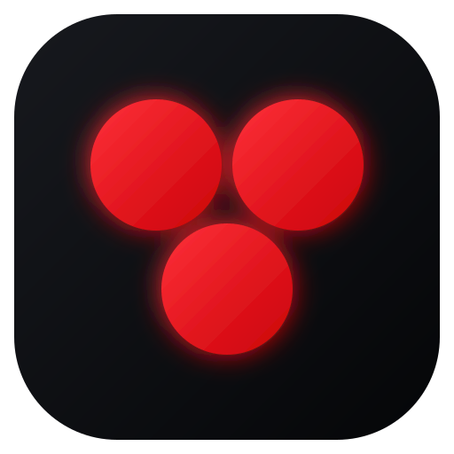
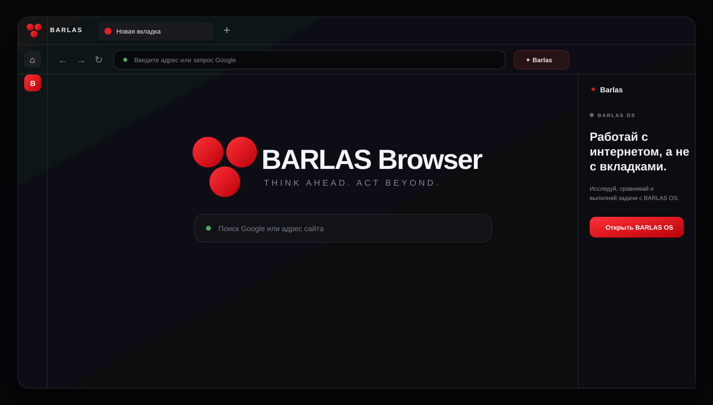

<div align="center">
  
  <h1>BARLAS Browser</h1>
  <p><strong>An AI-native desktop browser by Barlas Bit.</strong></p>
  <p>Think ahead. Act beyond.</p>

  [](https://www.electronjs.org/)
  [](LICENSE)
  [](#project-status)
</div>

<br>



BARLAS Browser is an open desktop browser built on Chromium and designed as
the web interface for **BARLAS OS**. The goal is not another reskinned browser:
it is a foundation for browsing, research, automation, and local AI assistance
in one controlled workspace.

> [!IMPORTANT]
> This repository is an early alpha. It is useful for development and testing,
> but it has not yet received the security review required for daily use with
> sensitive accounts.

## What works today

- Chromium-compatible browsing in independent tabs
- Google search directly from the address bar
- Back, forward, reload, stop, home, and common keyboard shortcuts
- Popup links converted into controlled tabs
- Persistent browser profile and native downloads
- Direct entry point to a local BARLAS OS instance
- Custom black-and-red BARLAS interface and application icon
- Isolated page processes with no Node.js access
- Deny-by-default policy for sensitive website permissions

## Quick start

Requirements: **Node.js 22+** on Windows, Linux, or macOS.

```bash
git clone https://github.com/WatcherAI-1997/barlas-browser.git
cd barlas-browser
npm install
npm start
```

BARLAS OS is expected at `http://127.0.0.1:17840`. To use another local URL:

```bash
BARLAS_OS_URL=http://127.0.0.1:3000 npm start
```

PowerShell:

```powershell
$env:BARLAS_OS_URL = "http://127.0.0.1:3000"
npm start
```

## Build

```bash
# Unpacked build for the current platform
npm run pack

# Windows x64 installer (run on Windows or a configured CI runner)
npm run dist:win
```

Build output is written to `release/`.

## Architecture

```text
BARLAS shell (trusted renderer)
        │ narrow IPC bridge
        ▼
Electron main process ───── BARLAS OS at 127.0.0.1:17840
        │
        ├── sandboxed Chromium tab
        ├── sandboxed Chromium tab
        └── persistent local browser session
```

Web pages never receive Node.js integration or direct access to the browser
shell. More detail is available in [docs/ARCHITECTURE.md](docs/ARCHITECTURE.md).

## Keyboard shortcuts

| Shortcut | Action |
| --- | --- |
| `Ctrl/Cmd + L` | Focus the address bar |
| `Ctrl/Cmd + T` | Open a new tab |
| `Ctrl/Cmd + W` | Close the current tab |
| `Ctrl/Cmd + R` | Reload the current page |
| `Alt + Left/Right` | Navigate through page history |

## Project status

Version `0.1.x` is the browser foundation. Bookmarks, history, session restore,
per-site permissions, content blocking, signed installers, and page-aware
BARLAS assistance are tracked in the [roadmap](docs/ROADMAP.md).

## Contributing

Issues and focused pull requests are welcome. Please read
[CONTRIBUTING.md](CONTRIBUTING.md) and the [Code of Conduct](CODE_OF_CONDUCT.md)
before contributing. Security problems must be reported privately according to
[SECURITY.md](SECURITY.md).

Automated checks are specified in [docs/CI.md](docs/CI.md). The workflow will
be activated after the repository credential receives GitHub's `workflow`
scope; the same commands already run locally.

## Русский

BARLAS Browser — открытый desktop-браузер на Chromium и будущий веб-интерфейс
BARLAS OS. Текущая alpha-версия уже поддерживает вкладки, Google-поиск из
адресной строки, загрузки, горячие клавиши, изоляцию сайтов и подключение к
локальному BARLAS OS. Перед использованием с важными аккаунтами проекту ещё
нужны аудит безопасности, управление разрешениями и тестирование на Windows.

## License

[MIT](LICENSE) © 2026 Barlas Bit
